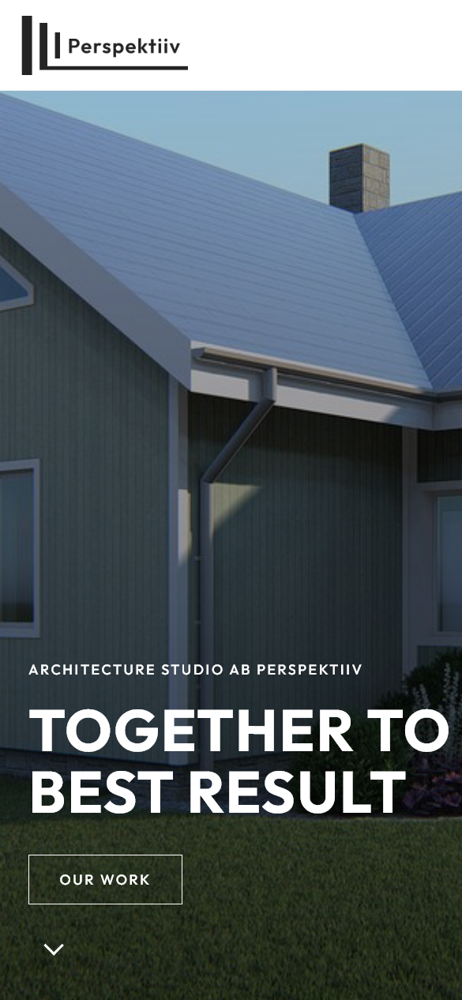
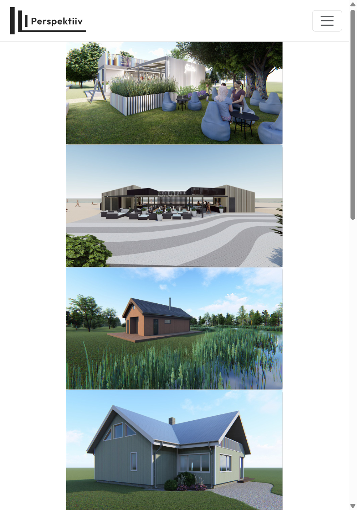

# AB Perspektiiv

A responsive website for an architecture and interior design studio. Visitors can explore services and project galleries, view the studio location, and contact the team. Authorized staff can manage projects and locations through a Firebase-backed admin area.

**Live site:** [abperspektiiv.com](https://abperspektiiv.com)

## Screenshots

<p align="center">
  
  
</p>

## Features

- Architecture and interior design galleries with project detail pages
- Responsive layouts and four interface languages: Estonian, English, Finnish, and Latvian
- Protected admin pages for managing projects and studio locations
- Firebase Realtime Database and Authentication integration
- Interactive studio map and contact form with server-side email delivery

## My contribution

- Developed and maintained the public React experience and Firebase-backed project management tools.
- Improved the mobile navigation and architecture hero layout.
- Migrated 43 image assets from Postimages to Firebase Hosting and optimized them, reducing their combined size from 10.49 MiB to 7.46 MiB (28.9%) without changing their URLs.

## Technology

- React 18, React Router 6, and Vite 6
- Firebase Authentication, Realtime Database, Hosting, and Cloud Functions v2
- Bootstrap 5 and React Bootstrap
- i18next and react-i18next
- Leaflet and React Leaflet
- Nodemailer for Gmail OAuth2 and SMTP; Resend for API-based email delivery

## Run locally

Requirements: Node.js and npm.

```bash
npm ci
npm run dev
```

Create a `.env` file in the project root and add the Firebase web app settings below before starting the development server. The `.env` file is local configuration and must not be committed.

| Variable | Description |
|----------|-------------|
| `VITE_FIREBASE_API_KEY` | Firebase web app API key |
| `VITE_FIREBASE_AUTH_DOMAIN` | Firebase Authentication domain |
| `VITE_FIREBASE_DATABASE_URL` | Realtime Database URL |
| `VITE_FIREBASE_PROJECT_ID` | Firebase project ID |
| `VITE_FIREBASE_STORAGE_BUCKET` | Firebase storage bucket |
| `VITE_FIREBASE_MESSAGING_SENDER_ID` | Firebase sender ID |
| `VITE_FIREBASE_APP_ID` | Firebase app ID |

Open [http://localhost:3000](http://localhost:3000).

### Contact form configuration

The local Vite server handles `/api/contact`. To test email delivery locally, configure one server-side provider in `.env`:

- Gmail OAuth2: `GMAIL_USER`, `GMAIL_CLIENT_ID`, `GMAIL_CLIENT_SECRET`, and `GMAIL_REFRESH_TOKEN`
- SMTP: `SMTP_HOST`, `SMTP_PORT`, `SMTP_USER`, and `SMTP_PASS`
- Resend: `RESEND_API_KEY`

`CONTACT_TO_EMAIL` and `CONTACT_FROM_EMAIL` are optional. Keep mail credentials server-side; never expose them through `VITE_` variables.

## Scripts

| Command | Description |
|---------|-------------|
| `npm run dev` | Start the local Vite development server |
| `npm run build` | Create the production build in `build/` |
| `npm run preview` | Preview the production build locally |
| `npm run deploy:hosting` | Build and deploy Firebase Hosting |
| `npm run deploy:functions` | Deploy the contact Cloud Function |
| `npm run deploy` | Build and deploy Hosting and Cloud Functions |
| `npm run emulators` | Start the Firebase Functions emulator |

## Main routes

| Path | Page |
|------|------|
| `/` | Home |
| `/portfolio` | Combined project gallery |
| `/arhitektuur` | Architecture projects |
| `/sisearhitektuur` | Interior architecture projects |
| `/project-page/:name` | Project details |
| `/services` | Services |
| `/contacts` | Contact form and map |
| `/admin` | Protected content management |

## Project structure

```text
src/
├── components/       Shared navigation, map, and page components
├── i18n/             Interface translations
├── lib/              Shared helpers
├── pages/
│   ├── admin/        Protected admin pages
│   └── global/       Public pages
├── store/            Authentication context
└── styles/           Global and page styles
functions/            Firebase Cloud Functions
tools/                Contact email handling and project utilities
```

## Project context

Built for AB Perspektiiv. Studio branding, project imagery, and photography belong to their respective owners; obtain permission before reusing them.
